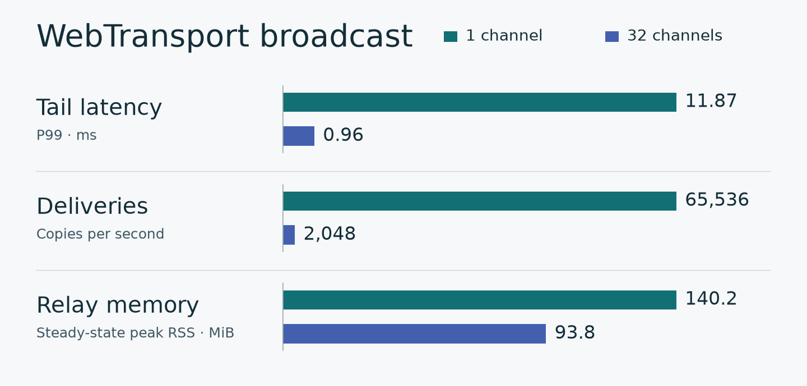

# PulseC

<p align="right"><a href="README.md" lang="zh-CN">简体中文</a> · <strong>English</strong></p>

[](https://github.com/Illusion2-1/PulseC/actions/workflows/check.yml?query=branch%3Amain)
[](go.mod)
[](LICENSE)

Share a channel link to start an anonymous chat in your browser. The relay keeps no chat history. Your tab keeps the messages it receives, so you can refresh the page and pick up where you left off.

The browser sends and receives messages over WebTransport. The Go relay and SvelteKit frontend ship as a single executable.

## Try it locally

On Linux, run this from the source tree or an unpacked binary distribution:

```sh
docker compose -f compose.yaml -f compose.local.yaml up -d --build
```

Open <http://127.0.0.1:8443>.

## Public deployment

- **Serve directly with PulseC.** PulseC listens on public ports 80 and 443. Compose runs Certbot for HTTP-01 issuance and renewal. Chat sessions stay connected during certificate rotation. [Direct deployment and renewal (中文)](docs/operations.md#direct)
- **Put Caddy in front.** Add PulseC as a site on your existing Caddy server. Caddy manages the public certificate and proxies WebTransport to a loopback listener. The upstream needs no certificate files. [Caddy setup (中文)](docs/operations.md#caddy)

## Chatting

- **Channels.** Share a link such as `/?ch=lobby`. Public channels appear in the directory. Anyone who knows an unlisted channel’s name can join it. Members can set the topic with `/topic`. The relay drops the channel state when the last person leaves.
- **Identity.** Nicknames can be shared. A tripcode is a tag derived from your password that people can recognize even if someone copies your nickname. The same password gives you the same tripcode on the same site. Use `/w nick#full-tripcode message` to send a private message. The relay can read private messages as it forwards them.
- **Local history.** Each tab keeps a separate history for each channel. Use `/clear` to clear the current channel’s history or `/forget` to clear local chat data. Your browser’s session restore settings affect what survives closing the tab.
- **Reconnecting.** After a disconnect, the client reconnects and processes queued messages. If delivery is uncertain, it asks you to check the original message. Messages sent while you were offline cannot be retrieved. Type `/help` in the chat box for the command list.

## How long does delivery take with 512 people online?

In a loopback test, 512 WebTransport clients on the same machine as the relay sent a combined 128 messages per second, each with a 128-byte body. With everyone in one channel, each message had 512 recipients. With clients spread evenly across 32 channels, each message had 16 recipients. Every expected copy arrived in every run.



The chart shows the median of three runs per scenario. In each run, clients sent messages for 30 seconds after everyone had joined. Delivery latency measures the time from the start of a sender’s write until a recipient has read the entire message. [Per-run data (`after-split`)](https://github.com/Illusion2-1/PulseC/blob/dd14242bdd7ca6e4ce97e2afb205e129f92a7392/qa/results/refactor-paired.jsonl) · [Reproduce the benchmark (中文)](qa/README.md)

## Build from source

Install Go, Node.js, npm, Python 3, and make. The minimum Go version is in [go.mod](go.mod). The [Dockerfile](Dockerfile) lists the toolchain used for the full build.

```sh
go test -race ./internal/...
make build
./dist/pulsec
```

The first command runs the Go backend tests with the race detector. For development checks, package boundaries, and wire formats, see the [contributing guide (中文)](CONTRIBUTING.md), [backend architecture (中文)](docs/architecture.md), and [relay protocol (中文)](docs/protocol.md).

PulseC uses the [MIT license](LICENSE). The running service serves license notices at `/LICENSE.txt`, `/THIRD-PARTY-Go.txt`, and `/THIRD-PARTY-Web.txt`.
