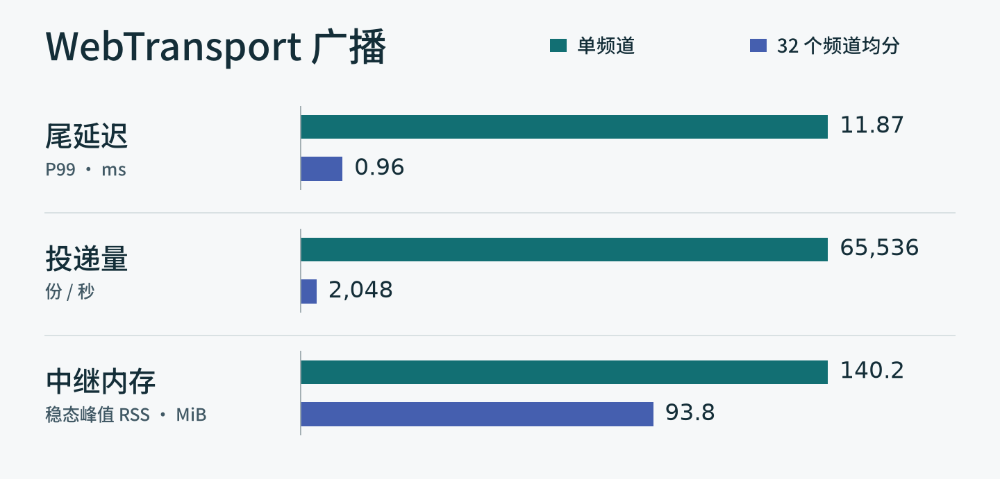

# PulseC

<p align="right"><strong>简体中文</strong> · <a href="README.en.md" lang="en">English</a></p>

[](https://github.com/Illusion2-1/PulseC/actions/workflows/check.yml?query=branch%3Amain)
[](go.mod)
[](LICENSE)

分享一个频道链接，就能在浏览器里匿名聊天。PulseC 的中继不保存聊天记录，刷新标签页仍能看到自己收到的消息。

浏览器通过 WebTransport 收发消息。Go 中继和 SvelteKit 前端打包成一个可执行文件。

## 本机试聊

在 Linux 上，从源码目录或解压后的二进制发行目录运行：

```sh
docker compose -f compose.yaml -f compose.local.yaml up -d --no-build
```

打开 <http://127.0.0.1:8443>。

## 公网部署

- **PulseC 直出** · PulseC 提供公网 80/443。Compose 自带 Certbot，负责 Let’s Encrypt 文件验证、签发和续期，换证时可继续聊天。[直出与续期](docs/operations.md#direct)
- **Caddy 反代** · 把 PulseC 作为一个站点加到已有 Caddy。Caddy 管理公网证书，同机的 PulseC 只监听回环地址，无需配置内网证书。[Caddy 配置与启动](docs/operations.md#caddy)

## 使用聊天室

- **频道**可以通过 `/?ch=频道名` 分享。公开频道显示在热门目录中，知道未列出频道名称的人也能加入。成员可用 `/topic` 改主题，最后一人离开时中继释放频道状态。
- **身份**由昵称和 trip 组成。昵称可以重名，同一站点使用同一密码会得到相同的 trip。用 `/w 昵称#完整trip 消息` 指定私聊对象。私聊由中继转发，中继可见正文。
- **本地记录**按标签页和频道保存，刷新可恢复已收消息。`/clear` 清空当前频道记录，`/forget` 清理本机聊天数据。浏览器的会话恢复功能会影响关闭标签页后的保留时间。
- **断线**后客户端会重连并处理待发队列。投递结果未知时会提示核对原文，离线期间未收到的消息无法补收。在聊天框输入 `/help` 查看命令。

## 512 人在线时，消息多久送达？

同一台机器上，512 个 WebTransport 客户端通过回环网络连接中继，每秒合计发送 128 条消息，每条正文 128 字节。所有人挤在一个频道时，每条消息投递给 512 人。均分到 32 个频道时，每条投递给 16 人。两种场景每轮都收齐了全部消息。



图中取每种场景三轮的中位数，每轮在全员入场后发消息 30 秒。P99 从发送端开始写入计时，到收件端读完整条消息为止。[逐轮数据（`after-split`）](https://github.com/Illusion2-1/PulseC/blob/dd14242bdd7ca6e4ce97e2afb205e129f92a7392/qa/results/refactor-paired.jsonl) · [复测方法](qa/README.md)

## 从源码开发

准备 Go、Node.js、npm、Python 3 和 make。Go 版本要求见 [go.mod](go.mod)，完整构建使用的工具链见 [Dockerfile](Dockerfile)。

```sh
go test -race ./internal/...
make build
./dist/pulsec
```

`./dist/pulsec -version` 查看版本。构建默认使用最近的 Git tag 与当前提交短 hash（如 `v0.1.0-rc.1-0a60961`）；可用 `make build VERSION=v1.0.0` 或 `docker build --build-arg VERSION=v1.0.0 .` 覆盖。底层通过 Go 的 `-ldflags "-X main.version=v1.0.0"` 注入。无 tag 时使用 `untagged-<hash>`，无 Git 信息时使用 `dev`；从源码归档重建时请显式传入 `VERSION`。

第一条命令单独验证 Go 后端。完整的开发检查、协议约定及测试入口见[贡献指南](CONTRIBUTING.md)、[后端架构](docs/architecture.md)和[中继协议](docs/protocol.md)。

PulseC 使用 [MIT 许可证](LICENSE)。运行中的服务在 `/LICENSE.txt`、`/THIRD-PARTY-Go.txt` 和 `/THIRD-PARTY-Web.txt` 提供许可声明。
