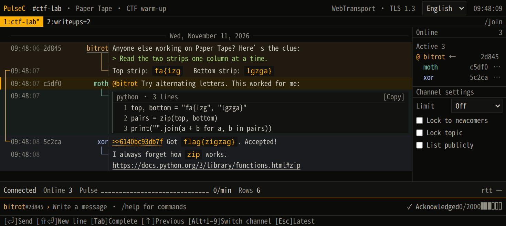
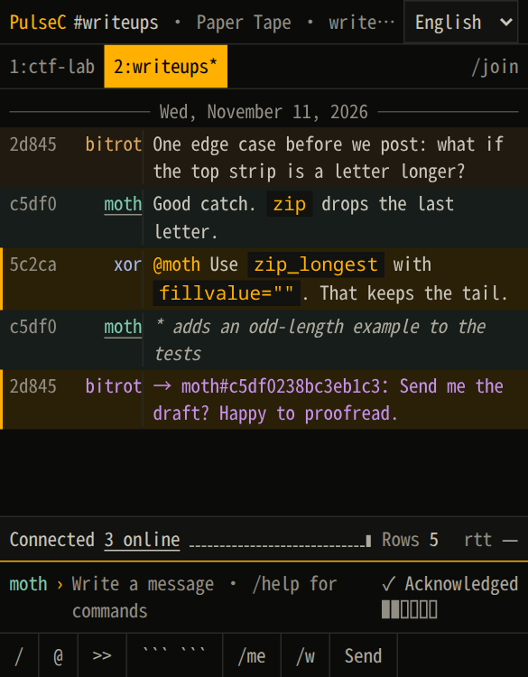
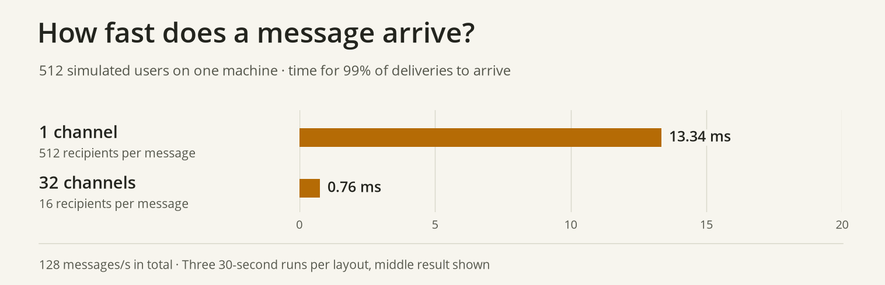

# PulseC

**English** · [简体中文](README.zh-CN.md)

PulseC is a self-hosted browser chat. Open a channel link and pick a nickname to join. Your CTF team can trade code snippets, quote a clue, or send a private reply without creating an account.

The server can read the messages it forwards, including private replies. It keeps no chat history. Your tab remembers recent messages across refreshes. People who join later see only new messages.



<details>
<summary>On mobile · reviewing the write-up</summary>



</details>



## Try it locally

On Linux with Docker Compose 2.24.4 or newer, run this from the project directory. If you unpacked the binary release, you can also start the server with `./pulsec`.

```sh
docker compose -f compose.yaml -f compose.local.yaml up -d --no-build
```

1. Open [the ctf-lab channel](http://127.0.0.1:8443/?ch=ctf-lab) in a browser that supports WebTransport, such as Chrome.
2. Pick a nickname, leave the password blank, and click `/join #ctf-lab`.
3. Open the same link in a second tab and join under another name. Send a message with **Enter** and watch it appear in both tabs. Type `/help` for chat commands.

## Host a room for others

Point your domain at a Linux server and open TCP ports 80 and 443 and UDP port 443. Add `PULSEC_DOMAIN=chat.example.org` to the project's `.env` file, using your own domain. Then run the command below. The included Certbot service obtains and renews the HTTPS certificate.

```sh
docker compose -f compose.yaml -f compose.direct.yaml up -d --no-build
```

When the certificate is ready, invite people to a channel by sharing a link like `https://chat.example.org/?ch=ctf-lab`.

Already running Caddy on the host? With a Caddy build that supports WebTransport proxying, set `PULSEC_BEHIND_PROXY=true` in `.env`, run the local Compose command above, and follow the [Caddyfile example](deploy/Caddyfile).

[MIT License](LICENSE)
