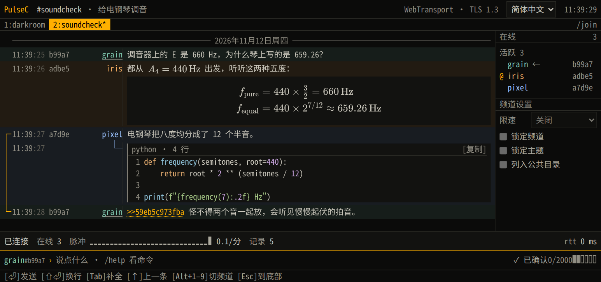

# PulseC

[English](README.md) · **简体中文**

[](https://github.com/Illusion2-1/PulseC/actions/workflows/check.yml)
[](https://hub.docker.com/r/illusionn21/pulsec)
[](LICENSE)


PulseC 是一个可以自己搭建的匿名聊天平台。点开频道链接，取个昵称，就能在浏览器里和大家聊天，无需注册。

服务器转发时能读到消息内容，包括私聊。服务器不保存聊天记录。刷新标签页，仍能看到自己最近收到的消息。后来加入的人只能看到入场后的新消息。

## 界面预览


<p>
  <a href="docs/soundcheck.zh-CN.png"></a>
  <a href="docs/mobile.zh-CN.png"></a>
</p>


## 在本机试聊

在装有 Docker Compose 2.24.4 或更高版本的 Linux 上，从项目目录运行以下命令。如果下载的是二进制发行包，解压后也可以直接运行 `./pulsec`。

```sh
docker compose -f compose.yaml -f compose.local.yaml up -d --no-build
```

1. 用支持 WebTransport 的浏览器（例如 Chrome）打开[本机大厅](http://127.0.0.1:8443/?ch=lobby)。
2. 取个昵称，密码留空，点击 `/join #lobby`。
3. 在第二个标签页打开同一链接，换个昵称加入。按 **Enter** 发条消息，两个标签页都能看到。输入 `/help` 可以查看聊天命令。

试试在句子里输入 `$x^2$`，或单独一行输入 `$$x^2$$` 来显示独立公式。贴代码时，第一行写 `` ```python ``，中间放代码，最后一行写三个反引号，就能看到语法高亮。按 **Shift+Enter** 可以换行。

## 搭一个能邀请朋友的聊天室

<p align="center"></p>

把域名解析到 Linux 服务器，开放 TCP 80、TCP 443 和 UDP 443 端口。在项目目录的 `.env` 文件里加一行 `PULSEC_DOMAIN=chat.example.org`，把示例域名换成自己的，然后运行以下命令。随附的 Certbot 服务会自动申请和续签 HTTPS 证书。

```sh
docker compose -f compose.yaml -f compose.direct.yaml up -d --no-build
```

证书就绪后，创建或进入频道，复制浏览器地址栏里的链接发给朋友即可，例如 `https://chat.example.org/?ch=lobby`。切换频道时，地址栏也会更新。

如果这台主机已经在运行支持 WebTransport 反代的 Caddy，可在 `.env` 中设置 `PULSEC_BEHIND_PROXY=true`，运行上面的本机试聊命令，再按 [Caddyfile 示例](deploy/Caddyfile) 配置站点。

[MIT 许可证](LICENSE)

## 致谢

感谢以下开源项目的维护者和贡献者。

- **聊天界面与构建** — [Svelte](https://svelte.dev)、[SvelteKit](https://github.com/sveltejs/kit)、[TypeScript](https://www.typescriptlang.org/) 和 [Vite](https://vite.dev)。
- **LaTeX 公式排版** — [KaTeX](https://katex.org)。
- **代码语法高亮** — [lowlight](https://github.com/wooorm/lowlight) 和 [highlight.js](https://highlightjs.org/)。
- **WebTransport、HTTP/3 与 TCP 连接数限制** — [webtransport-go](https://github.com/quic-go/webtransport-go)、[quic-go](https://github.com/quic-go/quic-go) 和 [Go netutil](https://pkg.go.dev/golang.org/x/net/netutil)。
- **前端与浏览器测试** — [Vitest](https://vitest.dev) 和 [Playwright](https://playwright.dev)。

二进制发行包中的 `THIRD-PARTY-Go.txt` 和 `THIRD-PARTY-Web.txt` 包含了第三方许可声明。
