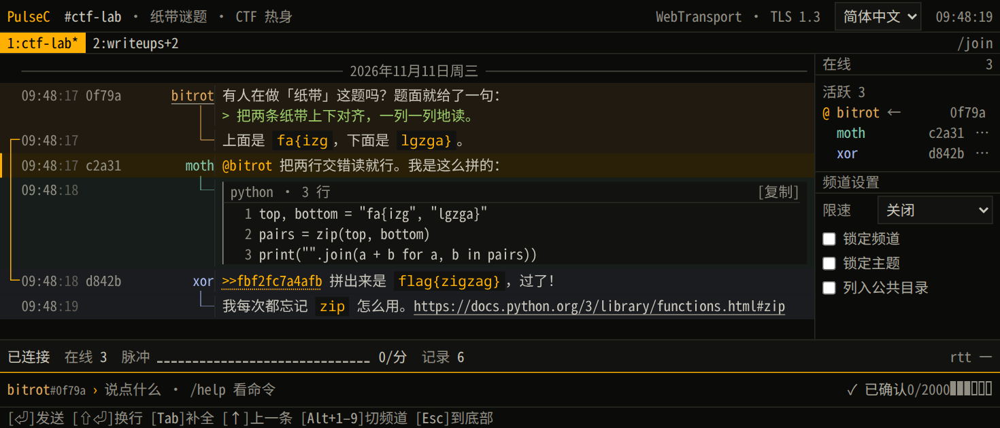
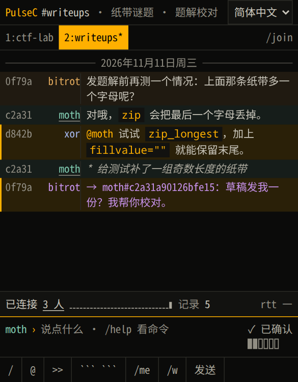
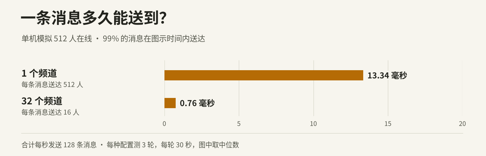

# PulseC

[English](README.md) · **简体中文**

PulseC 是一个可以自己搭建的网页聊天室。点开频道链接，取个昵称，就能和 CTF 队友贴代码、引用线索，也能单独给队友回消息，无需注册。

服务器转发时能读到消息内容，包括私聊。服务器不保存聊天记录。刷新标签页，仍能看到自己最近收到的消息。后来加入的人只能看到入场后的新消息。



<details>
<summary>看看手机上的题解讨论</summary>



</details>



## 在本机试聊

在装有 Docker Compose 2.24.4 或更高版本的 Linux 上，从项目目录运行以下命令。如果下载的是二进制发行包，解压后也可以直接运行 `./pulsec`。

```sh
docker compose -f compose.yaml -f compose.local.yaml up -d --no-build
```

1. 用支持 WebTransport 的浏览器（例如 Chrome）打开[本机的 ctf-lab 频道](http://127.0.0.1:8443/?ch=ctf-lab)。
2. 取个昵称，密码留空，点击 `/join #ctf-lab`。
3. 在第二个标签页打开同一链接，换个昵称加入。按 **Enter** 发条消息，两个标签页都能看到。输入 `/help` 可以查看聊天命令。

## 搭一个能邀请朋友的聊天室

把域名解析到 Linux 服务器，开放 TCP 80、TCP 443 和 UDP 443 端口。在项目目录的 `.env` 文件里加一行 `PULSEC_DOMAIN=chat.example.org`，把示例域名换成自己的，然后运行以下命令。随附的 Certbot 服务会自动申请和续签 HTTPS 证书。

```sh
docker compose -f compose.yaml -f compose.direct.yaml up -d --no-build
```

证书就绪后，把频道链接发给队友即可，例如 `https://chat.example.org/?ch=ctf-lab`。

如果这台主机已经在运行支持 WebTransport 反代的 Caddy，可在 `.env` 中设置 `PULSEC_BEHIND_PROXY=true`，运行上面的本机试聊命令，再按 [Caddyfile 示例](deploy/Caddyfile) 配置站点。

[MIT 许可证](LICENSE)
